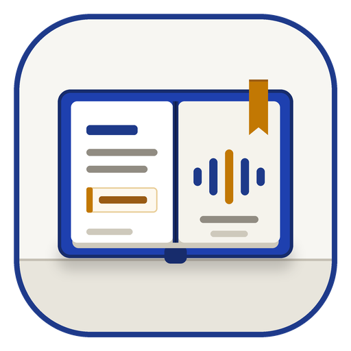
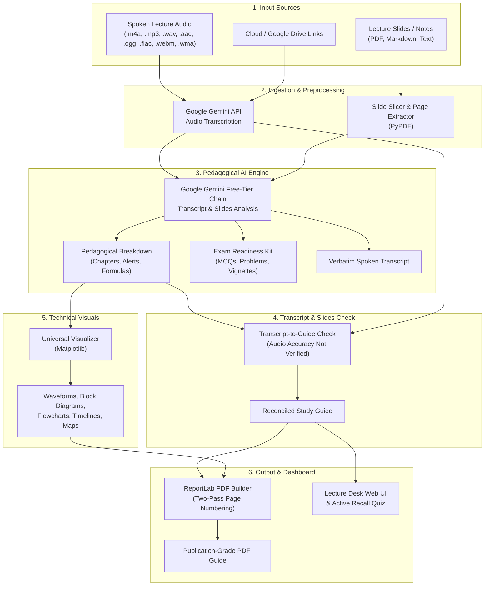

<div align="center">



# Lecture Desk — Engineering Study Suite

[](https://www.python.org/downloads/)
[](https://fastapi.tiangolo.com)
[](https://aistudio.google.com/apikey)
[](LICENSE)
[]()

**Turn university lecture recordings and slide decks into textbook-grade PDF study guides, diagrams, and active-recall exam quizzes — right on your computer.**

[Install in 3 Easy Steps](#-install--run-in-3-easy-steps-no-coding-required) • [Sample PDF](samples/demo_guide.pdf) • [What's Inside](#-what-lecture-desk-does) • [For Developers](#-for-developers-manual-setup--cli) • [Troubleshooting](#-troubleshooting)

</div>

---

## Install & Run in 3 Easy Steps (No Coding Required)

You do **not** need to know how to code or use a terminal to install **Lecture Desk**.

### Step 1 — Download & Unzip
1. **[Click here to download Lecture Desk (ZIP)](https://github.com/AbdelrhmanElhamy2/lecture-desk/archive/refs/heads/main.zip)**  
   *(Or click the green **Code** button above, then **Download ZIP**.)*
2. Find the downloaded `.zip` file in your **Downloads** folder.
3. **Right-click** it and choose **Extract All...** (Windows) or **double-click** it (Mac).
4. Open the extracted folder.

### Step 2 — Double-Click to Install & Open
- **On Windows:** Double-click **`Start_Lecture_Desk.bat`**
  - If Python isn't installed yet, it offers to install Python for you automatically (just press **Enter**).
  - On the first run (about 1–2 minutes), it sets up everything automatically and puts a **Lecture Desk** icon on your **Desktop**.
  - Next time, just double-click **Lecture Desk** on your Desktop — it opens in a couple of seconds!
- **On Mac:** Double-click **`Start_Lecture_Desk.command`**
  - *(If macOS shows a security prompt the first time: right-click the file -> **Open** -> **Open**.)*
- **On Linux:** Run `./start_lecture_desk.sh`

> **Want to try it immediately without any API key?**  
> As soon as Lecture Desk opens, click **Try Sample Lecture** to preview a full generated study guide, diagrams, PDF viewer, and active-recall quiz right away.

### Step 3 — Add Your Free Google Gemini API Key (Takes 30 Seconds)
To process your own lecture recordings, Lecture Desk uses Google's **free** Gemini API tier:

1. Go to **[Google AI Studio](https://aistudio.google.com/apikey)** and sign in with your Google account.
2. Click **Create API key** and copy the key.
3. Inside **Lecture Desk**, click **Settings** (top-right corner), paste your key, and click **Save API Key**.

That's it — you're ready to drop your first lecture recording and slides!

---

## How to Use Lecture Desk

1. **Drop your files** into the upload box (mix and match audio recordings, PDF slides, Google Drive links, or local course folders).
2. **Pick your Study Focus:**
   - **Detailed notes** — Full chapter breakdown, formulas, derivations, and key takeaways.
   - **Quick revision** — Compact, high-yield summary for rapid pre-exam review.
   - **Exam focus** — Professor cues, common traps, and expanded practice questions.
   - **Doctor's words & simple breakdown** — Exact translated wording paired with plain-English explanations and real-world examples.
3. **Click Generate Study Guide** — read it inside the app, practice with the **Active Recall Quiz**, or click **View PDF** / **Download PDF** for a print-ready study guide.

> **Sample Output:** Open [samples/demo_guide.pdf](samples/demo_guide.pdf) to see an example study guide compiled in demo mode (no live audio processed).

---

## What Lecture Desk Does

### Clean Editorial Workspace
- **Warm Paper Light** default theme and **Warm Charcoal Dark** toggle — designed for long study sessions without visual clutter.
- Three focused views in the top bar: **Create**, **Library** (search and filter your last 50 saved guides), and **Study Guide** reader.
- **One-Click Inline PDF Viewer** (`View PDF`) opens your finished study guide directly in a tab, alongside **Download PDF**.

### Unified Mixed-Source Intake
Combine materials from anywhere in a single lecture queue:
- **Computer Files:** Drag-and-drop audio (`.mp3`, `.m4a`, `.wav`, `.aac`, `.ogg`, `.flac`, `.webm`, `.wma` up to 2 GB per file) and slides/notes (`.pdf`, `.txt`, `.md`) into one smart dropzone — files sort automatically.
- **Google Drive & Direct Links:** Paste public Google Drive links or direct URLs.
- **Course Folders:** Scan local or Google Drive-synced semester folders by session name (e.g. `Lecture 1`, `Section 2`).
- **Multi-Part Lectures & Slide Ranges:** Reorder multi-part recordings chronologically and optionally limit each PDF deck to specific slide ranges (e.g. `Slides 5–28`).

### Bilingual Classroom & Code-Switching Support
- Transcribes multilingual lectures (including Arabic–English engineering/STEM code-switching) using Google Gemini's multimodal audio pipeline.
- Produces clean, formal academic English study guides and PDFs with zero missing-glyph boxes (`□`).

### Textbook-Grade PDFs, Math & Technical Diagrams
- **Collision-Free Vector Diagrams:** Automatically renders waveforms, system block diagrams, process cycles, flowcharts, bar charts, timelines, and concept maps in a print-friendly engineering palette.
- **Auto-Healing Math Typography:** Repairs broken equation tokens and renders clean, readable formulas in both the web reader and compiled PDF.
- **Two-Pass PDF Builder:** Print-ready layout with `Page X of Y` numbering, clickable chapter jump navigation in the web reader, and click-to-zoom diagram lightbox.

### Professor Exam Alerts & Active Recall Quiz
- **Professor Exam Highlights:** Extracts verbal warnings, grading hints, and common exam traps into dedicated callout boxes.
- **Interactive Active Recall Quiz:** Practice one question at a time inside the dashboard with keyboard shortcuts (`Space` to reveal answer, `1` for review, `2` for got it) and retry missed questions.
- **Transcript & Slides Check:** Cross-checks the generated guide against the transcript and selected slides, transparently noting discrepancies (while clearly noting that audio-to-transcript accuracy itself is not independently verified).

### Built for Engineering & STEM Disciplines
Includes customizable course presets across **Electrical**, **Mechanical**, **Computer & Software**, **Civil**, **Chemical**, **Biomedical**, and **Robotics & Systems** — plus 1-click custom courses saved locally in your browser.

---

## Free-Tier Gemini Models & Automatic Fallback

Lecture Desk is strictly configured to use **verified Free-Tier Google Gemini models only** (paid-only models are blocked so you never get surprise charges):

1. `gemini-4-hydrogen` *(Primary default)*
2. `gemini-3.8-flash` *(Flagship Flash)*
3. `gemini-3.6-flash` *(Balanced Flash)*
4. `gemini-3.5-flash-lite` *(Fast / High Quota)*
5. `gemini-3-flash-preview` *(Flash Preview)*
6. `gemini-3.1-flash-lite` *(Lightweight)*

If a model is temporarily busy (rate-limited or overloaded), Lecture Desk automatically falls back down this Free-Tier chain. You can switch your preferred default anytime in **Settings**.

---

## Privacy & Security

- **Your API key stays on your device:** Saved locally in `.env` (excluded from Git via `.gitignore`).
- **What goes to Google Gemini:** Audio recordings, transcripts, and selected slides/notes are processed through the **Google Gemini API** (under [Google's Gemini API Terms](https://ai.google.dev/gemini-api/terms)). Temporary audio files uploaded to the Gemini Files API are automatically deleted right after transcription. Sample mode (`Try Sample Lecture` / `--demo`) sends nothing over the network.
- **Everything else stays local:** Uploaded files (`uploads/`), generated PDFs (`output_pdfs/`), rendered diagrams (`generated_assets/`), and saved history (`lecture_history.json`) remain on your computer unless you opt into syncing with a local Google Drive folder.

---

## Troubleshooting

- **"Windows protected your PC" (SmartScreen popup) when opening `Start_Lecture_Desk.bat`:**  
  Click **More info** -> **Run anyway**. This appears on downloaded `.bat` files from GitHub because they aren't commercially code-signed.
- **Error saying the folder is read-only or `.venv` couldn't be created:**  
  Make sure you **extracted** the downloaded `.zip` file first (right-click the ZIP -> **Extract All...**). Don't double-click the launcher from inside the ZIP preview window.
- **"Gemini API Key is required" message:**  
  Click **Settings** at the top-right of Lecture Desk, paste your free key from [Google AI Studio](https://aistudio.google.com/apikey), and click **Save API Key** — or click **Try Sample Lecture** to test without a key.
- **macOS says `Start_Lecture_Desk.command` cannot be opened:**  
  Right-click (or Control-click) `Start_Lecture_Desk.command` in Finder -> click **Open** -> click **Open**.
- **Slow file dialog or large recordings:**  
  Drag-and-drop works directly onto the upload box. Lecture Desk streams local uploads up to 2 GB to disk in 1 MB chunks without buffering whole files into RAM.
- **Need to re-create the Desktop shortcut on Windows:**  
  Run `.venv\Scripts\python.exe create_desktop_shortcut.py` inside the app folder.

---

<details>
<summary><h2>For Developers: Manual Setup, CLI & Tests</h2></summary>

### Manual Setup (Windows, macOS, Linux)

```bash
git clone https://github.com/AbdelrhmanElhamy2/lecture-desk.git
cd lecture-desk

# Create and activate virtual environment
python -m venv .venv
# Windows:
.\.venv\Scripts\activate
# macOS / Linux:
source .venv/bin/activate

# Install dependencies
pip install -r requirements.txt

# Optional: configure .env (or enter key in the Settings modal)
cp .env.example .env

# Run desktop launcher (starts server + opens app window)
python launcher.py
# Or run FastAPI server directly at http://127.0.0.1:8000
python app.py
```

### Command-Line Interface (CLI)

```bash
# 1. Zero-cost simulation demo (no API key required)
python cli.py --demo

# 2. Process a lecture recording (modes: detailed | revision | exam | verbatim_explained)
python cli.py --audio "path/to/lecture.m4a" --mode exam

# 3. Combine audio with specific slide range
python cli.py --audio "lecture.m4a" --notes "slides.pdf" --start-slide 1 --end-slide 20

# 4. Stitch multi-part recordings chronologically
python cli.py --audio "part1.m4a" "part2.m4a" --notes "deck.pdf" --output "Lecture_01_Guide.pdf"

# 5. Process directly from a Google Drive share link
python cli.py --course "Power Electronics" --audio "https://drive.google.com/file/d/1.../view"

# 6. Run standalone transcript & slides auditor
python verify_audio_fidelity.py --audio "lecture.m4a" --notes "slides.pdf" --guide "cached_last_guide.json"
```

### Optional Course Folder / Google Drive Sync
Set `LECTUREAI_COURSES_DIR` in `.env` (for example `LECTUREAI_COURSES_DIR=G:\My Drive\fall 2026`), then:
```bash
python cli.py --list-courses
python cli.py --folder "Power Electronics" --session "Lecture 1"
```

### Automated Test Suite

```bash
python -m pytest -v
```

### System Architecture



### Repository Structure

```text
lecture-desk/
├── Start_Lecture_Desk.bat        # 1-click installer & launcher (Windows)
├── Start_Lecture_Desk.command    # 1-click installer & launcher (macOS)
├── start_lecture_desk.sh         # 1-click installer & launcher (Linux)
├── launcher.py                   # Desktop app-window launcher (.venv-aware)
├── create_desktop_shortcut.py    # Creates the Windows Desktop shortcut
├── app.py                        # FastAPI backend & REST API
├── cli.py                        # Command-line interface
├── pipeline.py                   # End-to-end processing pipeline
├── transcription.py              # Gemini multimodal audio transcription
├── pedagogy_engine.py            # Transcript/slide synthesis & verification
├── pdf_builder.py                # ReportLab PDF compiler & math healer
├── visualizer.py                 # Matplotlib technical diagram engine
├── models.py                     # Pydantic data schemas
├── link_downloader.py            # Google Drive & course folder loader
├── mock_generator.py             # Sample lecture demo generator
├── config.py                     # Free-tier model chain & paths config
├── verify_audio_fidelity.py      # Standalone transcript & slides checker
├── create_icon.py                # Generates editorial Lecture Desk icons
├── requirements.txt              # Python package dependencies
├── .env.example                  # Sample environment file
├── templates/index.html          # Lecture Desk web dashboard
├── static/                       # Stylesheet, client JS, and app icon
├── samples/demo_guide.pdf        # Pre-compiled sample study guide
└── tests/                        # Automated pytest suite
```

</details>

---

## License

Licensed under the [MIT License](LICENSE).
